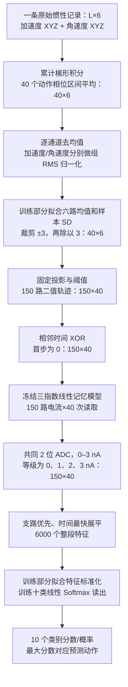

# 原理与流程

本项目把动作传感信号转换成固定动态模型的电流轨迹，再训练一个数字分类读出。动作输入来自真实记录；分类时的电流由实测器件响应校准的数学模型计算。阅读结果时，请同时参照 [科学表述与评价范围](科学表述与评价范围.md)。

## 用会漏水的水池理解记忆

可以把每路器件模型想成三只漏水速度不同的小水池。一个事件发生时，三只池子各加入固定量的水；没有事件时，水位逐渐下降。快池记住刚刚发生的变化，慢池保留更早的残留。读取时，把三只池子的水位按既定读取延迟衰减后相加，得到该路电流。

这里的“水位”对应模型状态，注水量对应增益，漏水速度对应时间常数。这个比喻解释的是数学记忆，没有断言真实器件内部由三种已确定的物理过程组成。150 路水池组彼此独立，使用同一条件下的三组参数；水不会从一路流入另一路。

分类器相当于观察员：它看完整段动作的 150 路、40 次读数，学习哪些组合更像左划、投掷或画圆。动作训练只改变观察员的读出权重，不改变池子的漏水速度和注水规则。

## 一条动作如何成为十类分数

下面省略批量计算中的“记录数”维度。`40×6` 表示 40 个时间区间、6 个输入通道；代码中的电流数组为时间优先的 `40×150`，图中用“支路×时间”写成 `150×40`，二者是同一组读数。



整个主流程的尺寸关系是 **`40×6 → 150×40 → 6000 → 10`**。150 是瞬时可观测电流通道数；每路有 3 个内部衰减状态，共 450 个。6000 是 `150×40` 个整段读数，不能把它称为 6000 个递归神经元。

完整记录首先按动作相位重采样。这保留动作内相对顺序，并把不同长度记录变成相同的 40 步；它不是原始传感时间戳的逐点硬件重放。每条记录的去均值和 RMS 使用整条动作，所以当前流程属于离线完整动作分类。XOR 本身只用当前和前一编码位，不代表整套预处理已经是在线因果算法。

## 150 路固定编码从哪里来

输入先用训练部分拟合的均值和样本标准差标准化，再裁剪到 `[-3,3]` 并除以 3。记处理后的六维输入为 `z[t]`。第 `b` 路编码位是：

```text
bit[t,b] = 1，当 z[t] · mask[b] > threshold[b]
           0，其他情况
```

前 54 路是单轴编码：6 个轴各配 9 个阈值，阈值从 `-0.8` 到 `0.8` 等距排列。后 96 路把多个轴组合起来：32 个符号投影，每个投影配 `-0.3、0、0.3` 三个阈值。投影与阈值是固定的数字设置，没有从动作标签训练出来。

32 个符号向量可以直接生成。令整数 `r=0,…,31` 的五个二进制位从高到低为 `b4,b3,b2,b1,b0`，对应投影为：

```text
mask_r = (1, 2b4−1, 2b3−1, 2b2−1, 2b1−1, 2b0−1) / sqrt(6)
```

第一轴符号固定为正，另外五轴各有正负两种选择，因此共有 `2^5=32` 组合。每个投影按上述三个阈值重复三次，得到 96 路。代码以严格大于号判断阈值，恰好等于阈值时编码为 0。

随后使用变化事件而非直接保持编码位：第一步事件固定为 0；后续一步与前一步相同则事件为 0，不同则为 1。这就是时间 XOR。每条动作独立开始，不把上一条动作的最后一个编码位接到下一条。

## 固定器件模型与读取

对支路 `b` 的第 `j` 个分量，主设置为：

```text
s[b,j,t] = exp(−Δ/τ[j]) · s[b,j,t−1] + g[j] · event[b,t]
I[b,t]   = Σ_j s[b,j,t] · exp(−δ/τ[j])
```

每条动作开始前 `s=0`。事件间隔 `Δ=0.13906 s`，事件到读出的延迟 `δ=0.07416 s`。以下列出冻结参数；正式计算使用随模型保存的完整浮点值。

| 条件 | 分量 | 时间常数 τ（s） | 增益 g（nA） |
|---|---:|---:|---:|
| 光照 LIGHT | 1 | 0.08638070691928003 | 1.259917290292193 |
| 光照 LIGHT | 2 | 0.8032903084305304 | 0.2122369073575212 |
| 光照 LIGHT | 3 | 6.301201267369912 | 0.027746611085924855 |
| 暗态 DARK | 1 | 0.10818938822269983 | 0.6808561750971406 |
| 暗态 DARK | 2 | 1.3848129005402599 | 0.042225804906512114 |
| 暗态 DARK | 3 | 10.97897239282255 | 0.00558970130419207 |

这两个模型结构相同，参数分别由对应器件响应拟合并冻结。动作识别不会重新拟合时间常数或增益。三指数是有效事件响应模型，不能仅由拟合良好就认定各分量对应唯一物理机制。

共同 ADC 把电流映射到最近的 `0、1、2、3 nA` 等级，超量程部分裁剪，恰好处在半等级时向上取整。例如 `0.5、1.5、2.5 nA` 分别变成 `1、2、3 nA`。2 位是本项目的读取条件，不是已经测量确证的仪器有效精度。核心函数的 `adc_bits=0` 表示不量化的浮点参考。

40 次读数全部保留，不做相邻两步平均。展平时先取第一支路的 40 次读数，再取第二支路的 40 次读数，依次得到 6000 维特征。

## 线性动态与数字非线性分别负责什么

`LIN` 描述三指数动态对事件输入的线性性。当前模型有递推记忆，但每个状态只保留自身衰减残留，没有随机支路间反馈连接。非线性操作位于数字阈值、XOR 和 ADC；Softmax 将十类分数转换为概率。

它不是 CNN：没有通过动作训练学习的卷积层或多层空间特征网络。虽然三指数动态可写成因果卷积，数学上的卷积不等于卷积神经网络。它也不是 TANH 储备池：没有 `tanh(Win·input + W·state)` 更新，不使用随机递归连接矩阵。旧研究脚本中的 TANH 比较属于另一条对照流程，不能当成当前定稿模型的一部分。

## 训练与结果的阅读方式

Softmax 读出用十类交叉熵和 L2 正则训练。输入标准化和 6000 维特征标准化都只由相应训练记录拟合。公共数据评价采用 8 折留一受试者，内层再按人分成 3 组，从固定七个 `C` 候选中选择读出正则；光照与暗态分别训练自己的读出。

公开参考的 `89.9439%` 和 `65.5208%` 是 8 名受试者各自准确率的等权平均；对应正确记录数为 `287/319` 和 `209/319`。全部 319 条数据训练的最终部署模型与外折评价模型是不同用途：部署模型的 `C` 分别为光照 `1`、暗态 `0.0001`，这些值也只由公共数据分组验证确定。

水池有记忆，不意味着它一定比直接编码分类更准确。当前直接 XOR 编码的岭回归基线为 `90.8894%`，高于共同 2 位读取下光照器件模型的 `89.0064%`。因此，本项目展示的是特定输入、动态和读取条件下的模型分类行为；是否产生额外计算收益，要由匹配的基线和新的评价数据回答。器件动态、读取条件、数据库历史使用和实测集合整理的完整边界见 [科学表述与评价范围](科学表述与评价范围.md)。

数值实现可对照 [core.py](../src/photo_synapse_rc/core.py)，数学关系和文献出处见 [文献与数学依据](文献与数学依据.md)。
